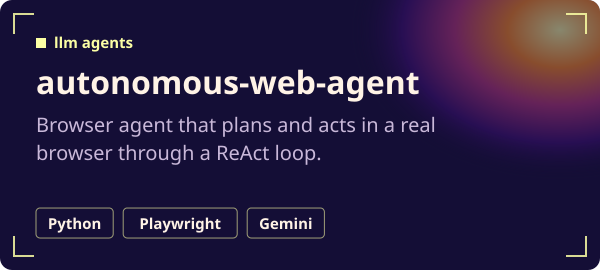
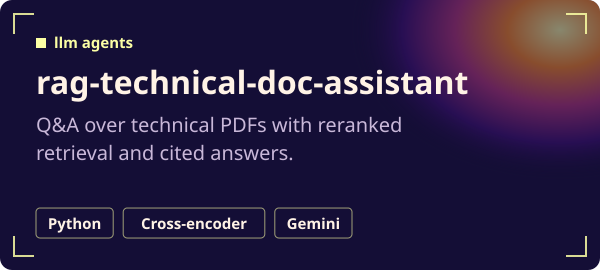
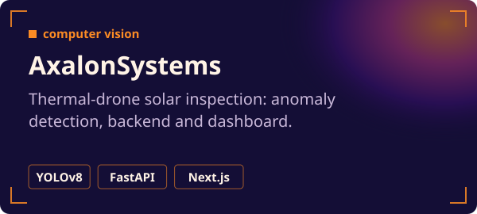
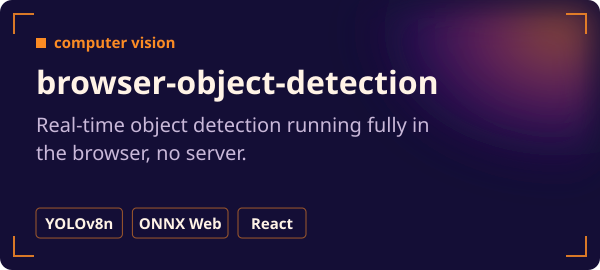
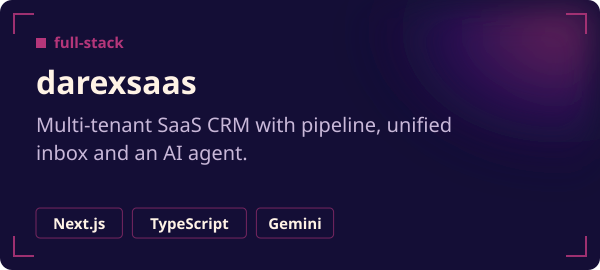
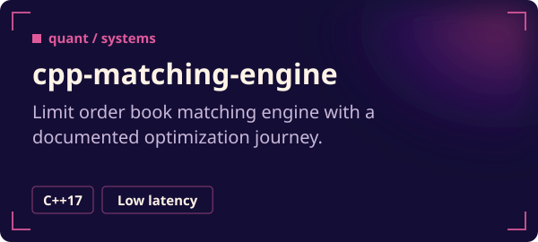
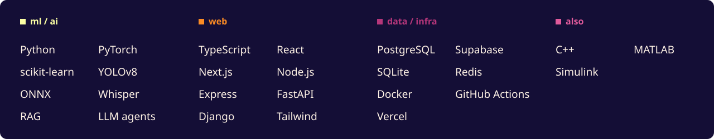

  <a href="mailto:sharmaparakh05@gmail.com"><b>sharmaparakh05@gmail.com</b></a>
  &nbsp;&nbsp;|&nbsp;&nbsp;
  <a href="https://parakh20.github.io/web-dev-mini-projects/">web gallery</a>
  &nbsp;&nbsp;|&nbsp;&nbsp;
  <a href="https://github.com/Parakh20?tab=repositories">all repositories</a>

I build LLM agents, RAG pipelines and computer vision systems, then ship them as web apps and APIs people can use. Mail me if you need one built.

### Featured work

  
  
  
  
  
  

<b>More AI and computer vision</b>

- [multi-agent-orchestration](https://github.com/Parakh20/multi-agent-orchestration): research, writing and review agents under an orchestrator, benchmarked against one agent
- [internblog](https://github.com/Parakh20/internblog): every new IIT Bombay internship blog post becomes a calendar event and a Telegram alert
- [edge-model-compression-study](https://github.com/Parakh20/edge-model-compression-study): FP16/INT8 quantization and pruning benchmark for YOLOv8s
- [AI-Video-Editor](https://github.com/Parakh20/AI-Video-Editor): raw POV footage in, edited video out, with highlights, beat-synced cuts and subtitles
- [recommendation-system](https://github.com/Parakh20/recommendation-system): hybrid recommender with adaptive weighting and MMR re-ranking
- [customer-churn-prediction](https://github.com/Parakh20/customer-churn-prediction) · [time-series-forecasting](https://github.com/Parakh20/time-series-forecasting)

<b>More full-stack</b>

- [careergps](https://github.com/Parakh20/careergps) ([live](https://career-gps-ai-roadmap.vercel.app/)): career decision-support MVP for students
- [comsync-task-api](https://github.com/Parakh20/comsync-task-api): task API with Docker, CI/CD, health checks, monitoring and rollback
- [AthleteSync](https://github.com/Parakh20/AthleteSync): training log and workout planning for athletes and groups
- [Task_Manager](https://github.com/Parakh20/Task_Manager) ([live](https://task-manager-ugac.vercel.app/)): Kanban board with drag-and-drop, calendar and dark mode
- [web-dev-mini-projects](https://github.com/Parakh20/web-dev-mini-projects) ([gallery](https://parakh20.github.io/web-dev-mini-projects/)) · [product-strategy-case-studies](https://github.com/Parakh20/product-strategy-case-studies)

<b>More quant and systems</b>

- [options-pricing-engine](https://github.com/Parakh20/options-pricing-engine): Black-Scholes, Monte Carlo and Longstaff-Schwartz pricing
- [limit-order-book-simulator](https://github.com/Parakh20/limit-order-book-simulator): order book plus backtesting for market-making strategies
- [ie622-rl-portfolio-seminar](https://github.com/Parakh20/ie622-rl-portfolio-seminar): recurrent PPO trading agent vs Markowitz and risk-parity baselines
- [bitcoin-blockchain-simulator](https://github.com/Parakh20/bitcoin-blockchain-simulator): Bitcoin protocol from scratch
- [summer-of-quant](https://github.com/Parakh20/summer-of-quant): BTC/USD volume-spike breakout strategy and backtest

### Toolbox

### Heat map

<picture>
  <source media="(prefers-color-scheme: dark)" srcset="https://raw.githubusercontent.com/Parakh20/Parakh20/output/snake-dark.svg">
  
</picture>

Visuals are generated by <code>tools/gen.py</code>. The heat map refreshes daily.
